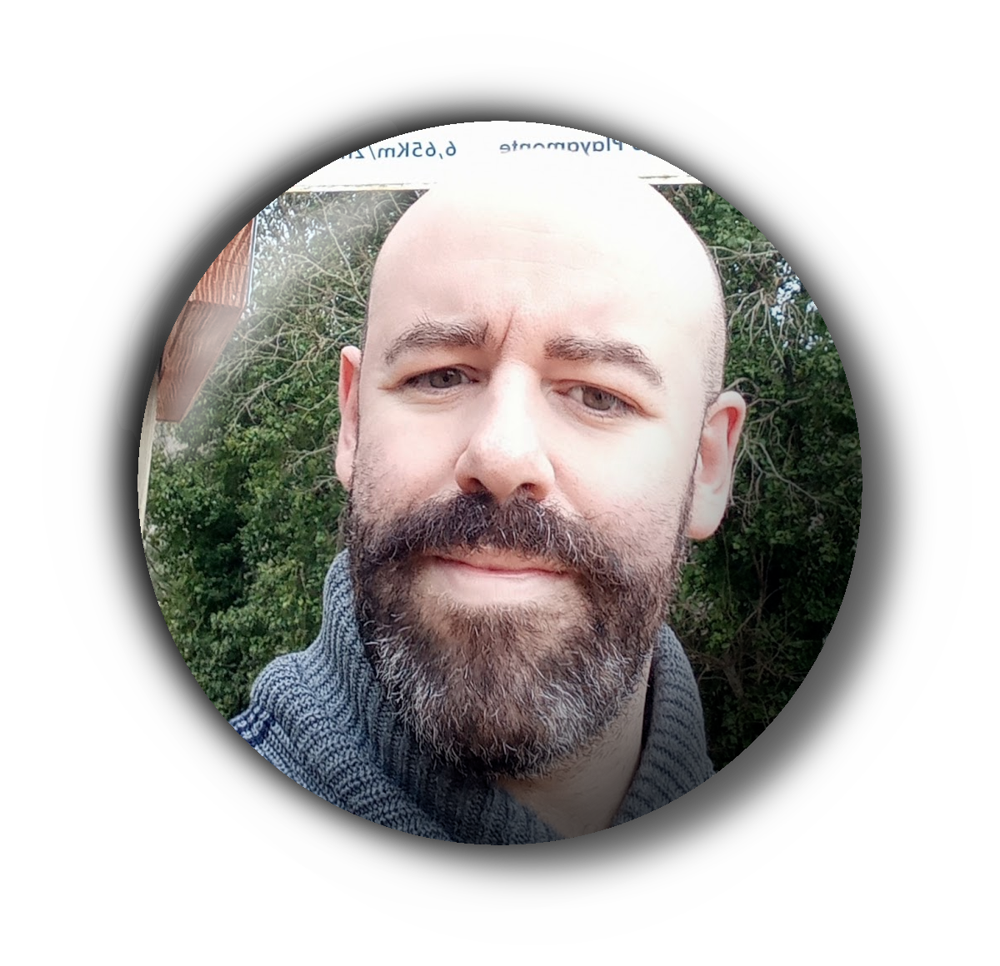

<table width="700">
<!-- Anchos ABSOLUTOS en px a proposito. El importador HTML de LibreOffice no
     respeta porcentajes al convertir a ODT: con width="100%" la columna del
     texto se estrecha y el nombre se parte en tres lineas. 700 px es el ancho
     util de A4 con los margenes por defecto (1,2 cm). -->
<tr>
<td width="90" valign="top" align="left"></td>
<td width="610" valign="top">
<h1>David Moreno Bolívar</h1>

<strong>Embedded Software Engineer · C/C++, Python, ESP32/STM32, Linux, FreeRTOS, Satellite IoT · New Space</strong>

</td>
</tr>
</table>

## Perfil Profesional

Ingeniero embebido con más de 20 años cerrando el ciclo hardware→firmware→cloud→operación: desde la **formación en electricidad industrial (FP2, cuadros, cableado, normativa, puesta en marcha)** y el diagnóstico hardware (Apple certified, reparación electrónica) hasta **firmware C/C++/Python en ESP32/STM32/Raspberry Pi**, **Linux embebido**, **protocolos serie (I2C, SPI, UART, CAN), MQTT, LoRa/LoRaWAN**, y **despliegue en Kubernetes HA**. He diseñado, programado y operado sistemas de extremo a extremo para IoT terrestre —la misma cadena dispositivo→conectividad→cloud que FOSSA Systems requiere para su constelación satélite (FOSSASat 3U/6U, FOSSA Nexus, ground stations, 25+ satélites lanzados).

Aporto solidez en **C, C++, Python low-level programming**, **debugging embedded systems (ESP32, STM32, Raspberry Pi)**, **Linux embebido**, **communication protocols (CAN, I2C, SPI, UART, MQTT, LoRa)**, y **documentación técnica detallada (design/implementation docs per standards)**. Mi ventaja diferencial es leer el hardware por debajo del firmware: sé cómo el power management, el clock domain, la integridad de señal y el ruido analógico afectan al firmware en entornos resource-constrained —crítico en nanosatélites (FOSSASat 6U: 12kg, 60W, propulsion electrospray, ADC <1º).

Trabajo a diario con agentes de código con IA: delego tareas acotadas, doy el contexto y las restricciones, sigo la ejecución y reviso, depuro y valido el resultado antes de darlo por bueno.

## Experiencia Laboral

### CTO de Infraestructura Física y Digital — Living Properties S.L.
**Agosto 2025 – Julio 2026**

- Dirigí la arquitectura tecnológica de soluciones IoT extremo a extremo, desde el **firmware ESP32-S3/C6 (C/C++, FreeRTOS concepts, Zigbee, MQTT, LoRa concepts)** hasta el despliegue en **Kubernetes HA** y monitorización cloud —misma cadena dispositivo→conectividad→cloud que FOSSA (FOSSASat → LoRa/LoRaWAN/S-Band/X-Band → Ground Station → API).
- Desarrollé **firmware embebido (C/C++, Python)** para gestión de periféricos Zigbee/MQTT/LoRa en **ESP32-S3, ESP32-C6**, con debugging HW/SW (JTAG, serial, osciloscopio básico), power management, signal integrity.
- Administré **servidores Linux** y optimicé entornos de ejecución (containers, systemd, redes TCP/IP) para sostener un **servicio continuo 24/7** con criterios de producción y observabilidad (logs, métricas, trazas).
- Diseñé e implanté redes **Zigbee/MQTT/LoRa** para gestión automatizada (edge → cloud, alta disponibilidad, medición tiempo real, gateway FOSSA Nexus equivalent).
- Definí procesos, documentación técnica y **especificaciones detalladas de diseño/implementación** (requirements→code→test traceability, design docs per standards) para incorporación de nuevos miembros y auditorías.

### Programador Entorno Embebido IoT en prácticas (FCT) — Living Properties S.L.
**Marzo 2025 – Junio 2025**

- Diseñé e implementé la lógica de control y la interfaz de usuario en **ESP32-S3** para gestión de periféricos **Zigbee/MQTT/LoRa** (Linux embebido, debugging JTAG/serial, power management, clock domain).
- Inicié la aplicación de apertura remota de puerta de acceso y resolví las primeras tareas de fabricación aditiva (impresión 3D, validación mecánica/eléctrica, integración HW/SW).

### Experiencia Anterior

**Propietario de MB Sistemas Informáticos (2005–2019)** — Negocio propio de reparación y venta de productos electrónicos: gestión de clientes, diagnóstico técnico y resolución de incidencias.

**Técnico certificado Apple (2019–2025)** — Reparación de hardware MacOS en entorno de servicio oficial.

**Formación práctica en electricidad desde 2002** — Auxiliar electricista en instalaciones industriales y viviendas: cuadros, cableado, normativa y puesta en marcha.

## Proyecto Destacado: Plataforma IoT de Extremo a Extremo

Sistema de control de acceso para edificios inteligentes, diseñado y desplegado de principio a fin:

**ESP32-C6** → red **Zigbee** → protocolo **MQTT** → **Node-RED** → despliegue en **Kubernetes** para alta disponibilidad.

Es el mismo recorrido que describe un puesto de desarrollo de software: un sistema que se diseña desde cero, se despliega en cloud y se opera con criterios de producción. La diferencia es que el punto de partida es el dispositivo, no el navegador.

## Tecnologías

**Backend y datos:** Python, C/C++, Java, JavaScript, Node.js, MySQL, APIs REST

**Cloud, infraestructura y DevOps:** Kubernetes (HA), Docker, GNU/Linux, LXC, Bash, Redes TCP/IP, Git, GitHub, CI/CD (GitHub Actions), documentación técnica (design/implementation docs per standards)

**Desarrollo web y móvil:** HTML/CSS, Flutter, Jetpack Compose, Electron, VS Code, Android Studio

**IoT y Hardware:** ESP32 (S3, C6), STM32 (familiaridad), Raspberry Pi, Arduino, Zigbee, MQTT, LoRa/LoRaWAN, CAN, I2C, SPI, UART, Node-RED, C/C++ (nivel intermedio para embebido), Linux embebido, FreeRTOS concepts, power management, signal integrity, JTAG/serial debugging, impresión 3D

## Formación

**C.F.S. Desarrollo de Aplicaciones Multiplataforma (DAM)** — IES Abastos, 2020–2025

**FP2 – Especialista en Instalaciones de Líneas Eléctricas** — Escuelas Profesionales Luis Amigó, 1996–2001

**Cursos relevantes:**
- Flutter – De cero a experto (50h)
- Hardware Hacking Bootcamp (2025)
- Hardware Hacking desde 0: Pirate Bus (2026)
- REST API con NodeJS y AdonisJS (2024)

Ingles: A2, sin certificado.

## Contacto

elarreglador@protonmail.com | <a href="https://elarreglador.eu/">elarreglador.eu</a> | <a href="tel:+34651737765">651 73 77 65</a> |  | 